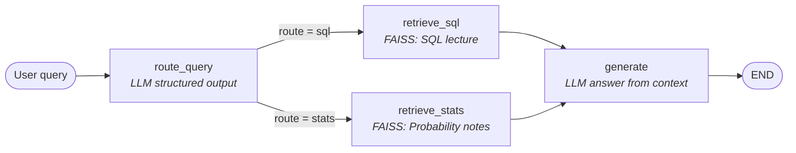

# Agentic RAG Router with LangGraph

A compact, end-to-end example of **query routing for Retrieval-Augmented Generation (RAG)** built with [LangGraph](https://github.com/langchain-ai/langgraph). An LLM inspects each incoming question, decides which of two domain-specific knowledge bases is most relevant, retrieves context from only that source, and generates a grounded answer.

The notebook is a LangGraph re-implementation of the LlamaIndex `RouterQueryEngine` + `LLMSingleSelector` pattern, expressed as an explicit, inspectable state graph.

---

## Overview

Many RAG systems dump every document into a single vector store. When the corpus spans unrelated domains, that approach tends to surface irrelevant chunks and dilute answer quality. A **router** solves this by first classifying the query and then sending it to a specialised retriever.

This project indexes two MIT OpenCourseWare PDFs into separate FAISS vector stores:

| Route   | Source document | Domain |
|---------|-----------------|--------|
| `sql`   | MIT 1.264J *Database, Internet, and Systems Integration Technologies* (Fall 2013), Lecture 15 | SQL and databases |
| `stats` | MIT 18.05 *Introduction to Probability and Statistics* (Spring 2022), probability notes | Probability and statistics |

A `gpt-4o-mini` router uses **structured output** (a Pydantic schema) to pick exactly one route per query, guaranteeing a valid, typed decision rather than free-form text.

---

## Architecture



### Graph state

All nodes read from and write to a shared `TypedDict`:

```python
class RouterState(TypedDict):
    query: str              # the user's question
    route: str              # "sql" or "stats", set by the router
    context: List[Document] # chunks returned by the selected retriever
    response: str           # final generated answer
```

### Nodes

| Node | Responsibility |
|------|----------------|
| `route_query` | Builds a prompt listing each tool and its description, calls `llm.with_structured_output(RouteDecision)`, and writes the chosen label to `state["route"]`. Logs the decision as `[router] selected tool: ...`. |
| `retrieve_sql` | Runs the query against the SQL FAISS retriever and stores the returned documents in `state["context"]`. |
| `retrieve_stats` | Same as above, using the probability/statistics retriever. |
| `generate` | Concatenates the retrieved chunks and asks the LLM to answer **using only that context**, replying "I don't know" if the answer is not present. |

Routing between `route_query` and the retrievers is handled by a **conditional edge** (`select_retriever`), so only one retrieval branch runs per query.

### Router schema

```python
class RouteDecision(BaseModel):
    tool: Literal["sql", "stats"] = Field(
        description="The single most relevant tool for answering the user's query."
    )
```

Constraining the output to a `Literal` type means the router cannot return an unknown route, which removes a common source of brittleness in prompt-based routing.

---

## Tech stack

| Component | Choice |
|-----------|--------|
| Orchestration | LangGraph (`StateGraph`, conditional edges) |
| LLM | OpenAI `gpt-4o-mini` via `langchain-openai` |
| Embeddings | OpenAI `text-embedding-3-small` |
| Vector store | FAISS (`faiss-cpu`), one index per domain |
| Document loading | `PyPDFLoader` (`langchain-community` + `pypdf`) |
| Chunking | `RecursiveCharacterTextSplitter` (chunk size 1024, overlap 100) |
| Validation | Pydantic structured output |

---

## Getting started

### Prerequisites

- Python 3.10+
- An OpenAI API key

### Option 1: Google Colab (as written)

The notebook is authored for Colab and reads the API key from Colab's secret manager.

1. Open `Router_LangGraph.ipynb` in Google Colab.
2. Add a secret named `OPENAI_API_KEY` (key icon in the left sidebar) and enable notebook access.
3. Run all cells. The PDFs are downloaded into `/content/data`.

### Option 2: Local Jupyter

1. Clone the repository and install dependencies:

```bash
   git clone <your-repo-url>
   cd <your-repo>
   pip install langgraph langchain langchain-openai langchain-community \
               faiss-cpu pypdf langchain-text-splitters jupyter
```

2. Set your API key:

```bash
   export OPENAI_API_KEY="sk-..."
```

3. Make two small edits before running:
   - Replace the Colab secret cell (`from google.colab import userdata ...`) with nothing, since `OPENAI_API_KEY` is already in your environment.
   - Update the PDF paths in `load_sql()` and `load_stats()` from `/content/data/...` to `data/...` (or wherever you downloaded the files).

4. Launch Jupyter and run the notebook:

```bash
   jupyter notebook Router_LangGraph.ipynb
```

---

## Usage

Once the graph is compiled, invoke it with a query:

```python
response = query_engine.invoke({"query": "What are transactions?"})
print(response["response"])
```

The returned object is the final graph state, so `response["route"]` and `response["context"]` are also available for inspection and debugging.

### Example results

**Query:** `What are transactions?`
**Router decision:** `sql`
**Answer (abridged):** Transactions are groups of operations treated as an atomic unit: either every operation is executed and committed, or all are rolled back on error, which preserves data integrity and consistency.

**Query:** `Explain Probability vs. Statistics`
**Router decision:** `stats`
**Answer (abridged):** Probability is logically self-contained and reasons forward from a known random process (e.g. the chance of 60+ heads from a fair coin), while statistics works backward from observed data to draw inferences about an unknown process, which can be more subjective.

---

## Project structure

```
.
├── Router_LangGraph.ipynb   # Main notebook
├── README.md
└── data/                    # Created at runtime; holds the downloaded PDFs
```

---

## Extending the router

**Multi-route retrieval.** To let a query draw on both knowledge bases at once:

1. Change `RouteDecision.tool` to `List[Literal["sql", "stats"]]`.
2. Replace the single conditional edge with a fan-out using LangGraph's `Send` API, dispatching to every selected retrieval node.
3. Merge the retrieved context from all branches (for example with a reducer on `context`) before `generate` runs.

**Adding more domains.** Load a new document into its own retriever, add an entry to `TOOL_DESCRIPTIONS`, extend the `Literal` in `RouteDecision`, and register a matching retrieval node and edge.

---

## Notes and limitations

- **Single-choice routing.** Each query is sent to exactly one retriever; questions spanning both domains will only receive context from one (see *Extending the router*).
- **Indexes are rebuilt on every run.** FAISS stores are created in memory and not persisted. For larger corpora, consider `vector_store.save_local()` / `FAISS.load_local()`.
- **Default retrieval depth.** Retrievers use LangChain's defaults (`as_retriever()` with no `search_kwargs`), returning the top 4 chunks.
- **Deprecation warning.** Recent versions of `langchain-community` emit a sunset notice on import. The loader still works, but migrating to a standalone integration package is recommended for long-term maintenance.
- **API costs.** Building the indexes calls the OpenAI embeddings API, and every query makes two chat completion calls (routing and generation).

---

## Acknowledgements

Source documents are provided by [MIT OpenCourseWare](https://ocw.mit.edu) under the Creative Commons BY-NC-SA license:

- [MIT 1.264J: Database, Internet, and Systems Integration Technologies (Fall 2013)](https://ocw.mit.edu/courses/1-264j-database-internet-and-systems-integration-technologies-fall-2013/)
- [MIT 18.05: Introduction to Probability and Statistics (Spring 2022)](https://ocw.mit.edu/courses/18-05-introduction-to-probability-and-statistics-spring-2022/)

The PDFs are downloaded at runtime and are not redistributed in this repository.
